# Pharmacy Harness for LINE

### 処方せんの受付から受け渡しまでを、LINE でつなぐ。

**患者は LINE から処方せんを送り、問診に答え、受付状況を確かめる。**
**薬局スタッフは 1 つの管理画面で、受付・準備・受け渡しを進める。**
Cloudflare Worker と D1 で動く、薬局向けの OSS です。汎用 LINE CRM の [LINE Harness](https://github.com/Shudesu/line-harness-oss) をフォークし、薬局業務の画面・データの分離・監査を `custom/pharmacy` として追加しています。

[画面を見る](#demo) · [できること](#features) · [使い方を選ぶ](#use-cases) · [導入する](#quickstart) · [データの行き先](#data) · [最新の更新](#release)

| 患者 | 薬局スタッフ | 運営（全体管理者） |
|---|---|---|
| LINE のメニューから開く LIFF（アプリ不要） | 管理画面（Next.js / Cloudflare Pages） | 管理画面内の `/platform-admin`（別認証） |

[](LICENSE)
[](tsconfig.base.json)
[](apps/worker/wrangler.toml)
[](package.json)
[](package.json)
[](https://github.com/yusuketakuma/pharmacy-harness-line/actions/workflows/repository-verify.yml)

この README は `dev` の最新のソース版を説明します。導入する版の変更点と更新手順は [CHANGELOG](CHANGELOG.md) と [Releases](https://github.com/yusuketakuma/pharmacy-harness-line/releases) で確認してください。
自動の LINE 通知は承認済みの定型文だけで、患者名や処方内容を含みません。本番への配備や LINE 側の設定変更は、すべて人が明示的に行います。[情報の行き先と安全の境界](#data)を導入前に確認してください。

<a name="demo"></a>

## 画面イメージ

実装した画面を、ローカル環境で架空の薬局・患者のデータを表示して撮影したものです。実在の薬局・患者・LINE アカウントの情報は含みません。

[処方せんの事前送信](#demo-prescription) · [受付状況](#demo-status) · [問診](#demo-intake) · [管理画面のホーム](#demo-home) · [受付キュー](#demo-queue) · [問診の確認](#demo-intake-admin)

<a name="demo-prescription"></a>

### LINE から、処方せんを事前に送る

| ① メニュー | ② 撮影して送信 |
|:-:|:-:|
| 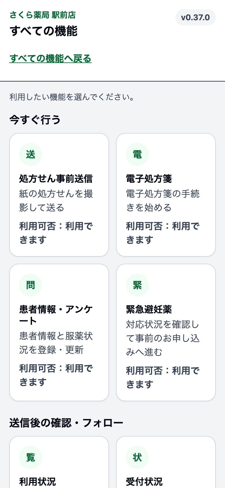 | 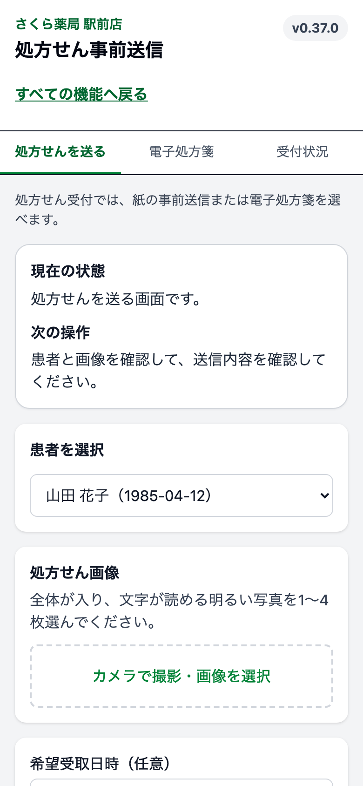 |
| 薬局が ON にした機能だけがメニューに並びます。 | 紙の処方せんを撮影して送ると、受付番号と「次にすること」が表示されます。 |

電子処方箋は、処方せん画面のタブから外部の手続きへ進みます。患者の申告と薬局の受領は別の事実として扱い、薬局スタッフが確認するまで受付完了にしません。
**原本の処方せんは、来局時に必ず提示が必要です。**

<a name="demo-status"></a>

### 受付状況を、いつでも確かめる

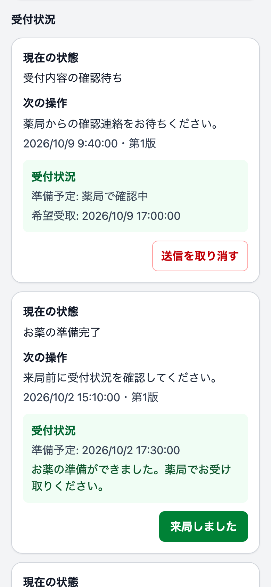

送信した処方せんごとに、現在の状態と次の操作、準備予定と希望受取を表示します。確認待ちのあいだは送信を取り消せ、準備ができたら「来局しました」で知らせます。準備ができると、LINE に定型文の通知も届きます。

<a name="demo-intake"></a>

### 問診は、3 ステップで答える

| ② 体調・生活 | ③ 確認・送信 |
|:-:|:-:|
| 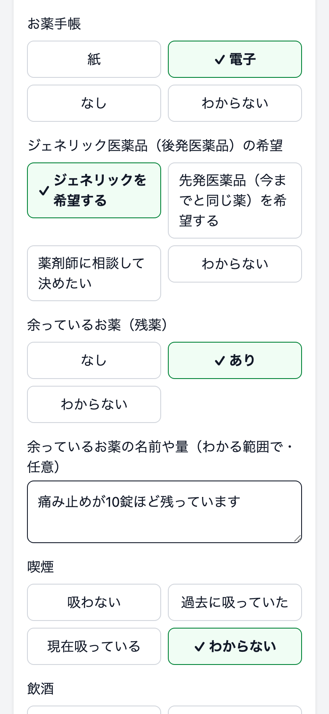 | 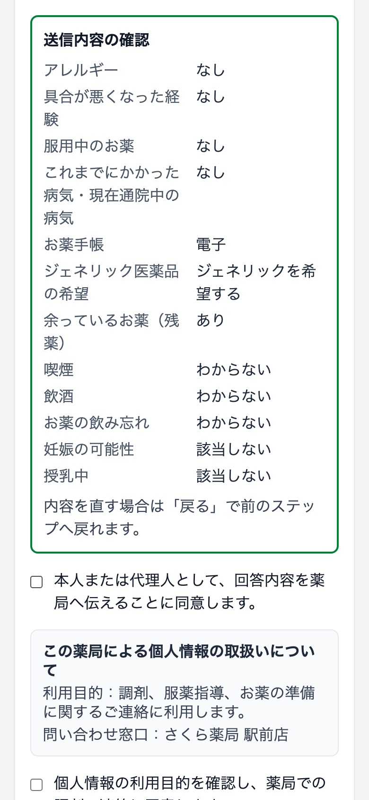 |
| お薬手帳、ジェネリック医薬品の希望、残薬の有無などに答えます。 | 回答の一覧を確かめてから送信します。 |

① の安全確認では、アレルギー、お薬で具合が悪くなった経験、服用中のお薬、病気の有無を、どれも明示的に選んでから次へ進みます。
回答はフィールド単位で暗号化して保存し、薬局のスタッフが管理画面で確認します。

<a name="demo-home"></a>

### 薬局は、今日の対応をホームで把握する

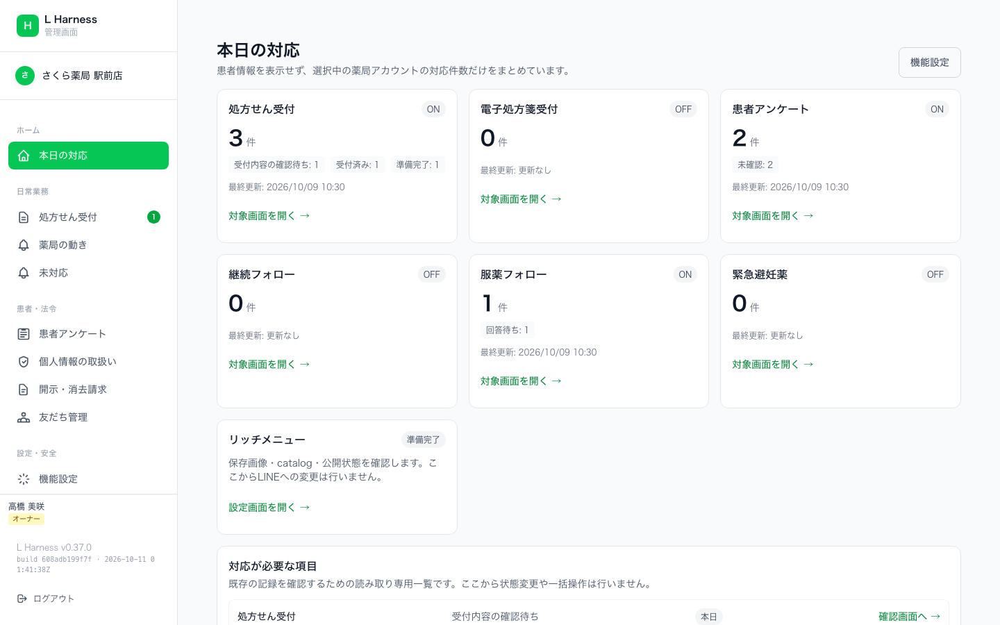

「本日の対応」に各キューの件数を表示します。サイドバーは「ホーム / 日常業務 / 患者・法令 / 設定・安全」の 4 つにまとまっています。

<a name="demo-queue"></a>

### 受付キューで、確認・準備・受け渡しを進める

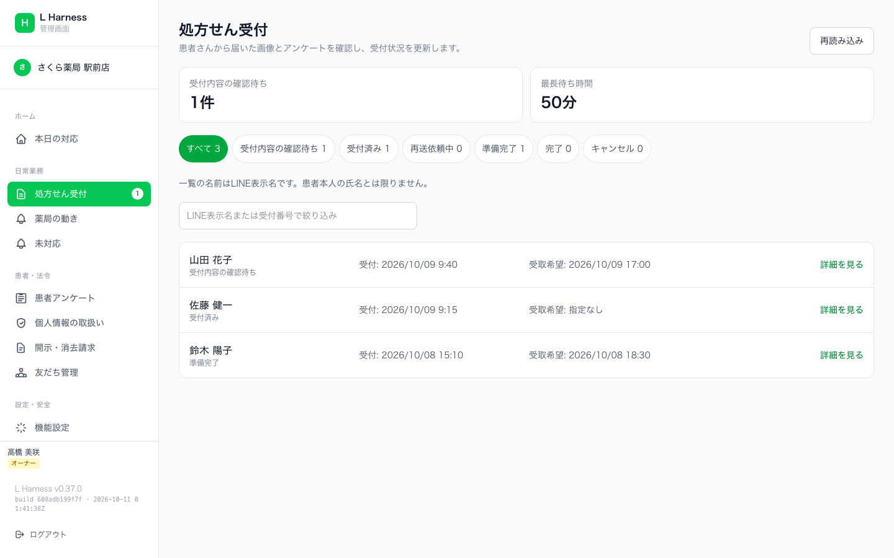

確認待ちの件数と最長待ち時間を上に表示し、受付を状態で絞り込んで確認・準備・お渡しへ進めます。一覧の名前は LINE の表示名です。処方せん画像の閲覧は監査ログに残ります。
受け渡し・取消・緊急停止などの取り消せない操作には、確認ダイアログと二重送信の防止があります。

<a name="demo-intake-admin"></a>

### 問診の回答を、管理画面で確認する

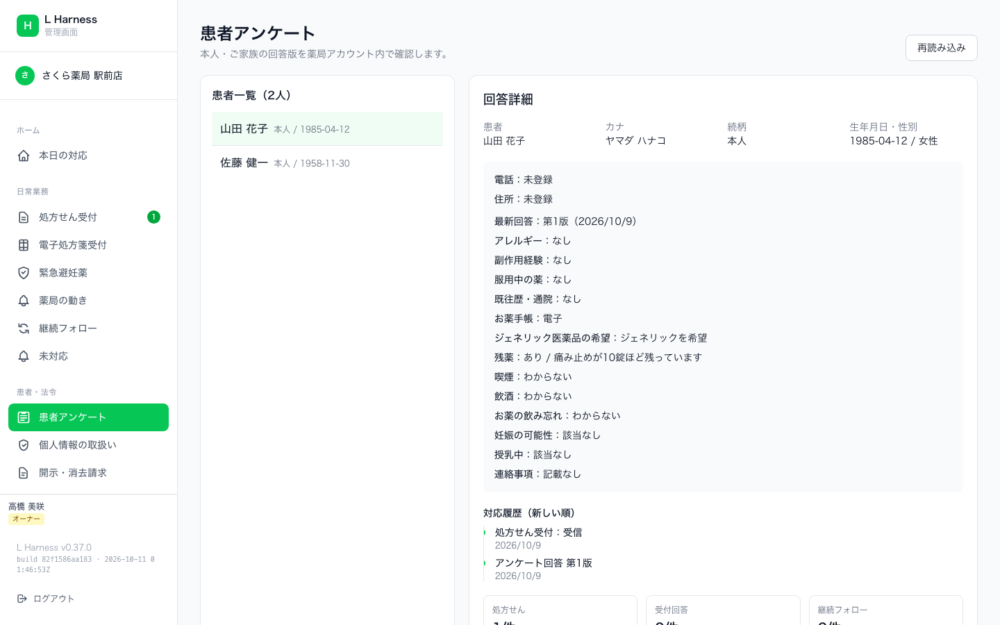

患者が LINE で答えた問診を、スタッフが管理画面で確認します。以前に登録された回答で、あとから追加した質問は「未回答」と表示します。

<details>
<summary><strong>全体管理者（運営）の画面でできることを開く</strong></summary>

- 薬局スタッフとは別の認証とセッションで入ります。初回の管理者を作った後は、作成用の経路が閉じます。
- 薬局（tenant）ごとに、職員、LINE 接続の診断、LIFF の設定、電子処方箋・緊急避妊薬の準備状況（`READY` / `UNVERIFIED` / `BLOCKED`）を確認できます。
- webhook の失敗を確認して手動で再試行でき（監査付き）、薬局単位で外向きの送信を一時停止できます。
- 患者の情報は、理由・対象の薬局・有効期限を持つ **support grant** があるときだけ参照できます。開始・終了・参照はすべて監査ログに残ります。
- 同じ操作を CLI の `pnpm tenant:settings` からも行えます（既定は dry-run、変更には明示的な確認が必要）。

</details>

<a name="features"></a>

## できること

| したいこと | Pharmacy Harness でできること |
|---|---|
| 来局前に処方せんを受け付ける | 患者が LINE で撮影・送信。受付番号と次にすることを表示し、受付状況をいつでも確認できる |
| 電子処方箋の手続きを案内する | 処方せん画面から外部の手続きへ進み、薬局スタッフが受領を確認してから受付完了にする |
| 来局前に問診を集める | 安全確認・体調と生活（ジェネリック医薬品の希望・残薬を含む）・確認の 3 ステップで登録・更新 |
| 受付から受け渡しまでを回す | 受付キューで確認・準備・お渡しを進め、準備ができたら定型文で LINE へ通知 |
| 次回の来局や服薬後の様子を確かめる | 継続フォローで次回の事前送信を案内し、服薬後フォローで患者の回答を受け取る |
| 緊急避妊薬の相談を受ける | 説明と同意 → 最小限の確認 → 対応枠の選択 → 仮受付番号 |
| 薬局の情報を案内する | 営業時間・処方せんの受付時間・アクセス・支払方法などを LIFF に表示 |
| 使う機能を選ぶ | 処方せん・電子処方箋・患者アンケート・継続フォロー・服薬フォロー・緊急避妊薬・個別チャット・薬局情報を LINE アカウントごとに ON/OFF |
| 個人情報の請求に対応する | 利用目的・窓口・ポリシーの版の管理と、開示・消去請求の処理 |
| 複数の薬局をまとめて運用する | 全体管理者画面で薬局の作成・診断・送信停止・期限付きの参照 |

LINE Harness の汎用 CRM 機能（友だち管理、タグ、個別チャット、シナリオ配信・テンプレート、リッチメニュー、リマインダ、IF-THEN 自動化、自動返信、Webhook、予約、スタッフ管理）もそのまま使えます。薬局モードでは、一斉配信やマーケティング系の通知を止めています。

**緊急避妊薬を販売するかどうかの最終判断は、店頭の薬剤師が行います。システムは判定しません。**

<a name="use-cases"></a>

## 使い方を選ぶ

<details>
<summary><strong>薬局で導入して、患者に LINE から処方せんを送ってもらいたい</strong></summary>

1. [導入手順](#quickstart)で Worker・管理画面・D1 を用意し、薬局（tenant）と管理者を作ります。
2. LINE 公式アカウントと LIFF を接続し、`pnpm tenant:settings -- --preflight --account-id <line_account_id>` で設定を確認します。
3. 管理画面の機能設定で、使う機能を ON にします。リッチメニューは素材のドラフトを作り、LINE への登録は人が行います。

[薬局の導入手順](docs/pharmacy/CUSTOMER_DELIVERY.md) · [患者向け 1 枚マニュアル](docs/pharmacy/manual-patient.md)

</details>

<details>
<summary><strong>受付から受け渡しまでを、スタッフで回したい</strong></summary>

1. ホームの「本日の対応」で、各キューの件数を確かめます。
2. 処方せん受付で内容を確認し、準備・お渡しへ進めます。準備ができると患者へ定型文で通知します。
3. 問診は患者アンケートで、次回の来局は継続フォローで確認します。

[薬局の日常運用ガイド](docs/pharmacy/OPERATION_GUIDE.md) · [スタッフ向け 1 枚マニュアル](docs/pharmacy/manual-staff.md)

</details>

<details>
<summary><strong>一部の機能だけを使いたい</strong></summary>

機能は LINE アカウントごとに ON/OFF できます。OFF にした機能はメニューに出ず、直接開いても利用できない旨を表示します（サーバー側でも拒否）。
OFF にしても止まるのは新しい受付だけで、受付済みの案件は完了・取消まで進められます。

</details>

<details>
<summary><strong>複数の薬局をまとめて管理したい</strong></summary>

全体管理者画面で薬局を作成し、LINE 接続や準備状況を診断します。患者の情報は期限付きの support grant があるときだけ参照でき、すべて監査ログに残ります。

</details>

<a name="quickstart"></a>

## クイックスタート

**導入前提:** Cloudflare アカウント、LINE 公式アカウント（Messaging API と LINE Login / LIFF）、Node.js 22 以上、pnpm 11.25.0。

```bash
pnpm install
wrangler login

# ローカルの新しい D1 を schema.sql + 追加型 migration から作る（リモートの更新には使わない）
pnpm --dir packages/db generate:bootstrap
wrangler d1 execute your-database --file=packages/db/bootstrap.sql --local

# リモート D1 へ追加型 migration を適用する（必要な環境変数と、人による明示の承認が必要）
pnpm tsx scripts/deploy/apply-migrations.ts

# Worker のデプロイと管理画面のビルド
pnpm build
pnpm deploy:worker
pnpm deploy:web             # Pages 用の管理画面を build するだけ

# 全体管理者の初回作成（未初期化の環境でだけ動く）
pnpm platform:admin-bootstrap

# 薬局（tenant）と管理者の作成、設定の確認
pnpm tenant:setup
pnpm tenant:settings -- --preflight --account-id <line_account_id>

# リッチメニュー素材の一覧（ドラフトを作るだけ。LINE への登録は別の操作）
pnpm rich-menu:catalog
```

各コマンドの引数と前提は `scripts/custom/pharmacy/` の各スクリプトを参照してください。変更を確かめるときは `pnpm verify:ci`（format・typecheck・test・migration の整合性）を実行します。

| 次に進む先 | 内容 |
|---|---|
| [薬局の導入手順](docs/pharmacy/CUSTOMER_DELIVERY.md) | 薬局（tenant）の導入と LINE の接続 |
| [日常運用ガイド](docs/pharmacy/OPERATION_GUIDE.md) | 1 日の業務の回し方 |
| [本番更新のチェックリスト](docs/pharmacy/customer-production-update-checklist.md) | 本番へ更新するときの確認 |
| [誤った LINE 紐付けの復旧](docs/pharmacy/WRONG_BINDING_RECOVERY.md) | 紐付けの停止と再登録 |

> 本番へのデプロイ、D1 への schema 適用、薬局の有効化、LINE 側の変更（リッチメニューの公開、初期表示の変更、友だちへの一括適用）は、すべて人が明示的に行う操作です。CLI と管理画面はドラフトの作成と検証までを行い、外部への反映を暗黙に実行しません。

<a name="data"></a>

## 仕組みと情報の行き先

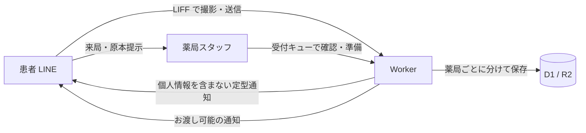

| 経路 | 保存・送信される情報 | 条件 |
|---|---|---|
| Cloudflare D1 / R2 | 患者情報、問診の回答（フィールド単位で暗号化）、処方せん画像（R2）、受付の状態、監査ログ | 薬局（LINE アカウント）ごとに分けて保存 |
| LINE への自動通知 | 承認済みの定型文だけ。患者名・LINE ID・処方内容を含まない | 受付・準備などの状態変化と、薬局が ON にした通知 |
| LINE の個別チャット | スタッフが入力した本文（オーナーが承認した定型文の挿入を含む） | 個別チャットを ON にし、スタッフが送信した場合 |
| 全体管理者 | 薬局の稼働・診断情報。患者の情報は期限付きの support grant があるときだけ | 運営の担当者が理由と期限を記録した場合 |

### 人が確認して判断するための境界

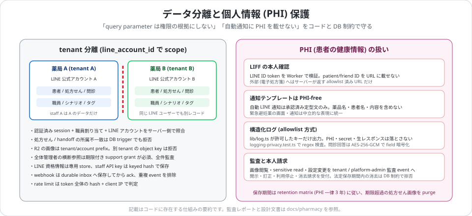

- **薬局ごとの分離。** すべての読み書きを LINE アカウント（`line_account_id`）と、認証済み職員の割り当てで絞り込みます。URL のパラメータや画面での選択を権限の根拠にしません。処方せんなどの所属の不一致は DB の trigger でも拒否します。
- **LIFF の本人確認。** LINE の ID token を Worker で検証します。患者 ID・友だち ID・LIFF ID を外部の URL に付けません。
- **個人情報を含まない通知。** 自動の LINE 通知に患者名・LINE ID・処方内容が入らないことをテストで確認しています。
- **ログと資格情報。** 構造化ログは許可したキーだけを残し、個人情報・秘密情報・リクエスト本文を渡しません。LINE の資格情報は専用の保存先、職員の API key は keyed hash で保存します。
- **監査。** 処方せん画像の閲覧、緊急避妊薬の要配慮情報の参照、薬局の管理操作、全体管理者の操作を記録します。
- **保存期間。** データ種別ごとの保存期間・legal hold・削除の方針を備えます。処方せん画像の削除ジョブは実装済みですが、法令への適合や全データ種別の削除完了はこの README では主張しません。
- **説明用の架空データだけをリポジトリへ。** 患者データ・秘密情報・実際の LINE アカウントの情報を入れません。

<details>
<summary><strong>システム構成とディレクトリを開く</strong></summary>

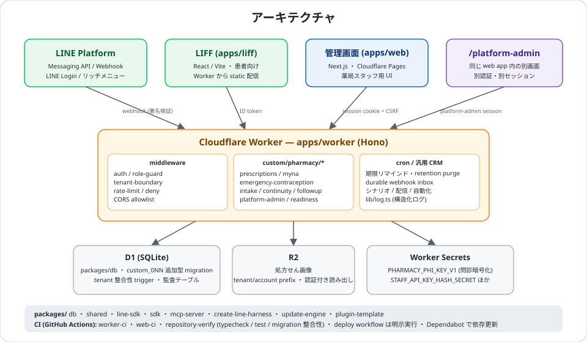

| パス | 役割 |
|---|---|
| `apps/worker` | Hono 製の Cloudflare Worker。API、LIFF の静的配信、LINE webhook、cron。薬局機能は `src/custom/pharmacy/*` |
| `apps/web` | Next.js の管理画面（Cloudflare Pages）。`/platform-admin` は同じアプリ内の別認証の画面 |
| `apps/liff` | React + Vite の患者向け LIFF。薬局の画面は `src/custom/pharmacy/*` |
| `packages/db` | D1 のスキーマ、追加型 migration（`custom_0NN_*.sql`）、bootstrap |
| `packages/shared` / `packages/line-sdk` | 型定義、LINE API の薄いラッパー |
| `packages/sdk` / `packages/mcp-server` | TypeScript SDK、MCP server（`src/custom/pharmacy/` に薬局向けリッチメニュー操作） |
| `packages/create-line-harness` / `packages/update-engine` / `packages/plugin-template` | フォーク元由来のセットアップ CLI・更新エンジン・プラグイン雛形 |
| `scripts/custom/pharmacy` | 薬局の作成、管理者の初回作成、設定 CLI、リッチメニュー catalog |

コードの詳しい構造は Devin が生成する wiki（`AGENTS.md` の「Devin Wiki」節）を参照してください。

</details>

<a name="faq"></a>

## よくある質問

<details>
<summary><strong>患者はアプリを入れる必要がある？</strong></summary>

いいえ。普段使いの LINE のメニューから開く LIFF で使います。

</details>

<details>
<summary><strong>システムが処方や販売の可否を判断する？</strong></summary>

しません。処方せんの内容確認や、緊急避妊薬を販売するかどうかの最終判断は、薬局の薬剤師が行います。AI による画像の読み取りや自動判定も行いません。

</details>

<details>
<summary><strong>機能を OFF にすると、受付中の案件はどうなる？</strong></summary>

止まるのは新しい受付だけです。受付済みの案件は、完了・取消まで進められます。

</details>

<details>
<summary><strong>dev に反映すると、本番にも配備される？</strong></summary>

されません。`dev` への反映で自動配備されるのは開発環境だけです。本番への配備は、承認したコミットを指定して人が明示的に実行します。

</details>

<a name="release"></a>

## 最新の更新

**v0.37.0 · 2026-10-11** — **問診でジェネリック医薬品の希望と残薬を答えられるように**

LINE の問診で「ジェネリック医薬品の希望」と「余っているお薬（残薬）の有無」を答えられるようになりました。薬局スタッフは、管理画面の患者アンケートでその回答を確認できます。

| 変更 | 以前 | 今回 | 利用者のメリット |
|---|---|---|---|
| 問診の項目 | 問診にジェネリック医薬品の希望・残薬を答える欄がなかった | 問診の2ページ目で選んで答えられ、残薬が「あり」のときは内容も書ける | 患者は来局前に LINE で伝えられ、薬局は管理画面で回答を確認できる |
| リリース処理 | v0.36.4 以降、tag を push すると Release 作成の前に検査が失敗していた | 必要なパッケージを先に組み立ててから検査する | tag から Release が自動作成される |
| README | 2026-08 時点の画面と説明図のまま | 現在の画面のスクリーンショットで全面的に作り直した | 導入を検討する人が、実際の画面で機能を確かめられる |

<details>
<summary>更新時の注意を開く</summary>

- データベースの migration はありません。Worker・管理画面・LIFF を同時に更新する必要はありません。
- 新しい LIFF は、古い Worker に対しては新しい2問を表示せず、送信前に新しい項目を取り除くため、切り戻した構成でも問診を送信できます。
- 実機の LINE での問診表示の確認と、本番への反映は未実施です。

</details>

[すべての変更と技術詳細](CHANGELOG.md) · [GitHub Releases](https://github.com/yusuketakuma/pharmacy-harness-line/releases)

### バージョンについて

リリースはソースコードの tag `vX.Y.Z` と package version（`package.json`、CHANGELOG の「Pharmacy vX.Y.Z」）で行います。2026-10-11 以降、販売者向けリリース `pharmacy-v*` は新しく作成しません。過去の `pharmacy-v*` の tag と証跡は履歴として残しています。ソース版とは別の識別子なので、片方からもう片方を推測しないでください。
ローカルのコード、テストの通過、リリースの記録、デプロイの証跡、本番での稼働は、それぞれ別の事実として扱います。

<a name="docs"></a>

## ドキュメント

| 読む目的 | 文書 |
|---|---|
| 患者・スタッフの使い方 | [患者向け 1 枚マニュアル](docs/pharmacy/manual-patient.md) · [スタッフ向け 1 枚マニュアル](docs/pharmacy/manual-staff.md) · [日常運用ガイド](docs/pharmacy/OPERATION_GUIDE.md) |
| 導入・更新・復旧 | [薬局の導入手順](docs/pharmacy/CUSTOMER_DELIVERY.md) · [本番更新のチェックリスト](docs/pharmacy/customer-production-update-checklist.md) · [誤った紐付けの復旧](docs/pharmacy/WRONG_BINDING_RECOVERY.md) · [リッチメニュー更新の確認](docs/pharmacy/rich-menu-update-review.md) |
| データの扱い・安全の境界 | [SECURITY](SECURITY.md) · [テナント所有と認可](docs/pharmacy/MULTITENANT_OWNERSHIP_MATRIX.md) · [フィールド暗号化](docs/pharmacy/FIELD_LEVEL_ENCRYPTION_DESIGN.md) · [保存期間](docs/pharmacy/RETENTION_MATRIX.md) · [管理画面の認証](docs/pharmacy/ADMIN-AUTH.md) |
| 設計・不変条件・証跡 | [実装計画と不変条件](docs/pharmacy/IMPLEMENTATION_PLAN.md) · [セキュリティレビュー証跡](docs/pharmacy/SECURITY_REVIEW_EVIDENCE_2026-08-19.md) · [証跡](docs/pharmacy/evidence) · [docs の案内](docs/README.md) |
| 変更履歴・計画 | [CHANGELOG](CHANGELOG.md) · [PLANS.md](PLANS.md) |
| このリポジトリで作業する | [AGENTS.md](AGENTS.md) · [CONTRIBUTING.md](CONTRIBUTING.md) |

脆弱性の報告は [SECURITY.md](SECURITY.md) に従い、非公開で行ってください。

## ライセンス

[MIT License](LICENSE)。フォーク元の LINE Harness と同じく、商用利用・改変・再配布は自由です。
汎用 CRM 部分の改善は、フォーク元の [Shudesu/line-harness-oss](https://github.com/Shudesu/line-harness-oss)（野田修一 [@Shudesu](https://github.com/Shudesu)）へ送る方が全体のためになります。
